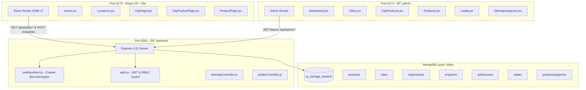
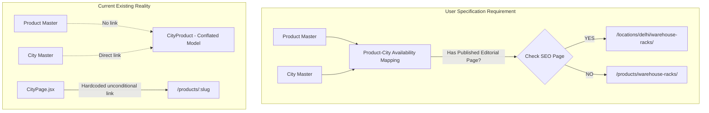
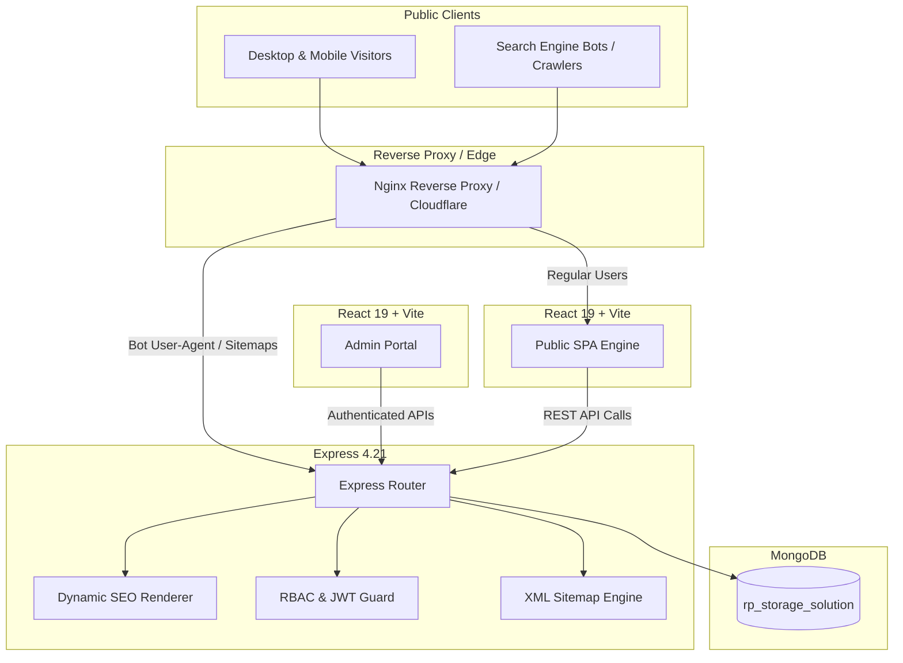
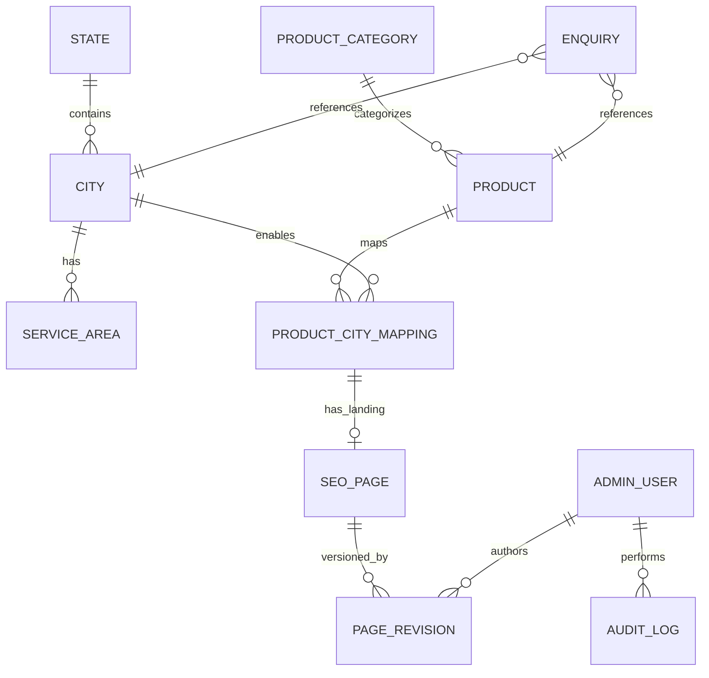
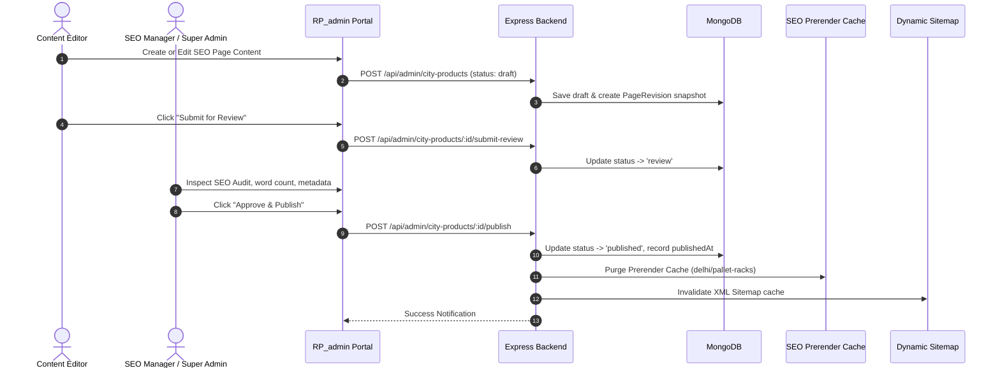
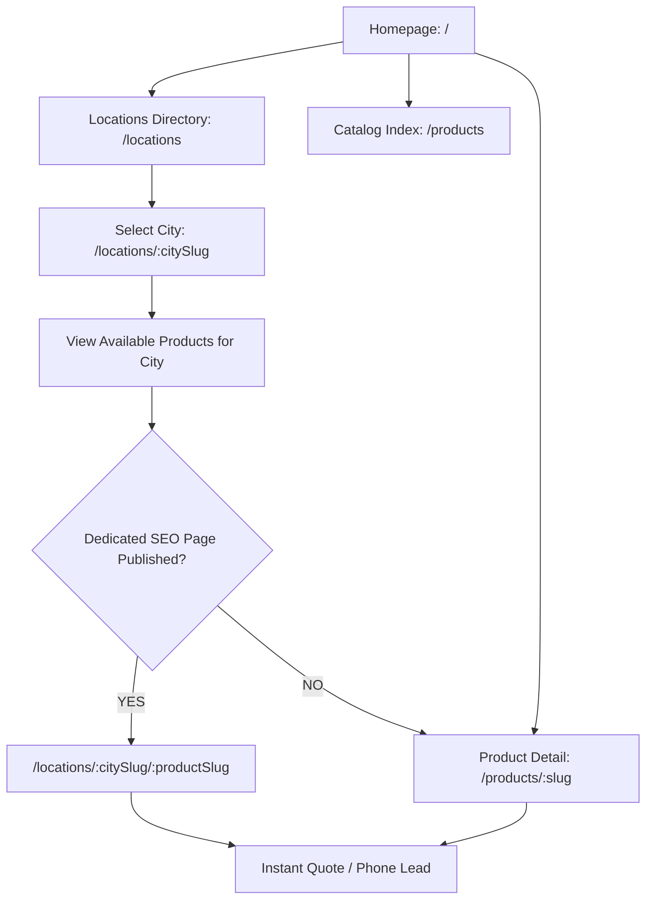
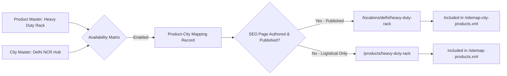
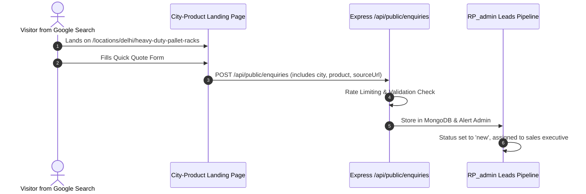

# RP Storage Solution — Programmatic SEO Audit Report

**Date of Audit:** October 15, 2026  
**Audit Type:** Technical Architecture, Data Model, Dynamic Routing, Technical SEO & Security Audit (Read-Only)  
**Target Public Production Website:** [https://www.rpstoragesolution.com/](https://www.rpstoragesolution.com/)  
**Document Classification:** Internal Technical Audit & Architecture Blueprints  
**Audit Author:** Principal Full-Stack Software Architect, Senior React Engineer, Node.js Backend Specialist, MongoDB Database Architect, Technical SEO Expert, DevOps Engineer & Application Security Auditor  

---

## 1. Executive Summary

This comprehensive, strictly read-only technical audit investigates the codebase and data architecture of the **RP Storage Solution** enterprise system. The ultimate objective is to plan and establish a fully dynamic, enterprise-grade **Product × City Programmatic SEO Engine with Admin CMS**.

RP Storage Solution is an established industrial storage rack and supermarket display rack manufacturer based in Najafgarh, New Delhi, supplying heavy-duty racking, mezzanine floors, cantilever racks, supermarket gondolas, and retail checkout fixtures across Delhi NCR, Haryana, Uttar Pradesh, and northern industrial belts.

### Key Audit Conclusions

1. **Foundational Codebase Status (`PARTIAL`):**
   - A multi-tier architecture exists comprising three applications:
     - **Public Web Application (`/`)**: React 19, Vite 8, React Router v7, GSAP, Tailwind CSS.
     - **Admin Management Portal (`/RP_admin`)**: React 19, Vite 8, Lucide React, Tailwind CSS.
     - **REST Backend Engine (`/RP_backend`)**: Node.js, Express 4.21, Mongoose 8.9, MongoDB (`rp_storage_solution`).
2. **Core Architectural Gap — Conflation of Product-City Availability vs. SEO Landing Pages (`CRITICAL`):**
   - The user specification mandates a strict separation of four concepts:
     1. *Product Master*
     2. *City Master*
     3. *Product-City Availability Mapping*
     4. *Published City-Product SEO Page*
   - Currently, the backend contains only `models/CityProduct.js`. This model conflates logistical availability with full editorial SEO page content. A business cannot declare "Heavy Duty Pallet Racks" available in 20 NCR towns without publishing 20 distinct custom editorial long-form documents. A dedicated `ProductCityMapping` model is completely missing.
3. **Dynamic Public Navigation & Fallback Resolution Defect (`CRITICAL`):**
   - In `CityPage.jsx` (lines 434–436), products displayed for a city are fetched unconditionally from global catalog records and hardcode links to `/products/:slug`.
   - The required decision tree (`IF dedicated published SEO page exists -> /locations/:citySlug/:productSlug ELSE -> /products/:slug`) is completely unaddressed on the frontend.
4. **Data Desynchronization & Hardcoded Mock Data (`HIGH`):**
   - The public homepage (`RP/src/pages/Home.jsx` & `FeaturedProducts.jsx`) imports static arrays from `src/data/companyData.js` instead of consuming live MongoDB records via `/api/public/homepage` or `/api/public/products`. Products created in the admin panel never appear on the public homepage.
   - The admin panel (`RP_admin/src/pages/Products.jsx`) hardcodes product categories in local component state (`categories` array), bypassing the backend `ProductCategory` collection entirely.
5. **SEO & Crawl Engine Vulnerabilities (`HIGH`):**
   - The root static sitemap (`RP/public/sitemap.xml`) contains fragment anchor URLs (`/#about`, `/#contact`, `/#featured-products`), violating Google Search Central standards.
   - Vite is configured purely as a client-side SPA. While the Express backend has an intelligent crawler middleware (`seoRenderer.js`), bots requesting pages directly from the Vite dev server or a static web host receive empty `<div id="root"></div>` markup.
   - Cascade unpublishing is absent: unpublishing a City leaves dependent `CityProduct` records orphaned and indexable.

---

## 2. Audit Scope and Method

### 2.1 Audit Scope
The audit examined all directories, configuration files, backend routes, models, controllers, public frontend pages, admin screens, build pipelines, and SEO assets within `/Users/rajjeet/Developer/RP`.

### 2.2 Audit Methodology
- **Non-Destructive Static Inspection:** Comprehensive source code tracing without modifying, deleting, or injecting lines into existing source files.
- **Data Model Extraction:** Verification of schema definitions, index declarations, foreign key references, and enum validations.
- **API Surface Profiling:** Mapping public and admin routes against controller logic and middleware security chains.
- **Rendering & Crawl Analysis:** Analysis of React SPA hydration, React Helmet asynchronous tag injection, and bot-intercept server prerendering.
- **Zero-Mutation Enforcement:** No database records were written, migrated, altered, or dropped. No server processes were restarted.

---

## 3. Project Environment

| Environment Dimension | Observed State / Configuration | Evidence File / Source |
| :--- | :--- | :--- |
| **Current Execution Mode** | Local Development & Verification | `localhost:5173`, `localhost:5174`, `localhost:5001` |
| **Node.js Environment** | Node v20+ / ESM Module System (`"type": "module"`) | `package.json`, `RP_backend/package.json` |
| **Operating System** | macOS (Darwin 24.x / Apple Silicon arm64) | Active host environment metadata |
| **Public Frontend App** | Port `5173` (Vite v8.3.0, React 19.2.8) | `/Users/rajjeet/Developer/RP/vite.config.js` |
| **Admin Panel App** | Port `5174` (Vite v8.3.0, React 19.2.8) | `/Users/rajjeet/Developer/RP/RP_admin/vite.config.js` |
| **Backend REST API** | Port `5001` (Express v4.21.2) | `/Users/rajjeet/Developer/RP/RP_backend/src/server.js` |
| **Database Instance** | MongoDB Local `mongodb://127.0.0.1:27017/rp_storage_solution` | `RP_backend/src/config/db.js` |
| **Production Target Host** | `https://www.rpstoragesolution.com/` | `RP/src/components/seo/SEOHead.jsx` |
| **Git Repository** | Active local git branch with uncommitted UI work | Local workspace git status |

---

## 4. Existing Architecture



---

## 5. Frontend Audit

### 5.1 Architecture & Stack
- **Framework:** React 19.2.8 with `@vitejs/plugin-react` v8.3.0.
- **Routing:** `react-router-dom` v7.18.4 (`BrowserRouter`, `Routes`, `Route`).
- **Styling:** Tailwind CSS v3.4.19 with custom corporate brand palette (`#E85B12` industrial safety orange, `#161616` dark steel).
- **Animations:** GSAP 3.14 (`ScrollTrigger`, timeline pinning, stagger effects).
- **Icons:** `lucide-react` v1.16.0.
- **Head Management:** `react-helmet-async` v3.0.0.

### 5.2 Page Routing Manifest (`RP/src/App.jsx`)
```
Route 1: /                               -> <Home />
Route 2: /locations                      -> <Locations />
Route 3: /locations/:citySlug            -> <CityPage />
Route 4: /locations/:citySlug/:productSlug -> <CityProductPage />
Route 5: /products/:slug                 -> <ProductPage />
Route 6: *                               -> <NotFound />
```

### 5.3 Detailed Findings & Gaps

| Component | Status | Evidence Path | Gap / Defect Identified | Severity | Priority |
| :--- | :--- | :--- | :--- | :--- | :--- |
| **Catalog Route `/products`** | `MISSING` | `RP/src/App.jsx:70` | No route exists for `/products`. Only `/products/:slug` is mapped. Direct requests to `/products` hit `<NotFound />`. | `HIGH` | Phase 4 |
| **Dynamic Resolution in City Page** | `MISSING` | `RP/src/pages/CityPage.jsx:435` | Products on City page unconditionally navigate to `/products/${p.slug}` rather than resolving dedicated city SEO landing pages. | `CRITICAL` | Phase 4 |
| **Homepage API Binding** | `PARTIAL` | `RP/src/pages/Home.jsx:8`, `FeaturedProducts.jsx:5` | Homepage sections (Featured Products, Categories, About) pull from static file `data/companyData.js` instead of backend API. | `HIGH` | Phase 2 |
| **Initial HTML Meta Injection** | `PARTIAL` | `RP/src/components/seo/SEOHead.jsx` | Uses `react-helmet-async`. Works client-side after JS bundles execute, but initial HTML has generic static metadata unless routed through Express `seoRenderer`. | `HIGH` | Phase 7 |

---

## 6. Admin Panel Audit

### 6.1 Architecture & Stack (`RP_admin`)
- **Port:** `5174` (Vite 8, React 19, Tailwind CSS).
- **Authentication State:** `RP_admin/src/context/AuthContext.jsx` using `localStorage` token storage and `axios` authorization interceptors.
- **Layout:** `RP_admin/src/layouts/AdminLayout.jsx` with collapsible responsive sidebar and user role badges.

### 6.2 Module Status Matrix

| Module | Status | File Path | Existing Capabilities | Missing Required Capabilities | Severity |
| :--- | :--- | :--- | :--- | :--- | :--- |
| **Product Master** | `PARTIAL` | `RP_admin/src/pages/Products.jsx` | Product modal, CRUD, specs map, duplicate action, status filter. | Categories are hardcoded in React state; cannot manage categories; no bulk availability matrix. | `HIGH` |
| **City Master** | `EXISTS` | `RP_admin/src/pages/Cities.jsx` | City CRUD, service verification status, FAQs, state selector, publishing guard. | State list is hardcoded; no service area / micro-locality multi-select. | `MEDIUM` |
| **Product × City Availability** | `MISSING` | Non-existent | None. | Dedicated UI to assign products to verified cities without creating full SEO landing pages. | `CRITICAL` |
| **City-Product SEO Landing CMS** | `PARTIAL` | `RP_admin/src/pages/CityProducts.jsx` | Form for title, meta, custom content, custom FAQs, publish toggle. | No revision history; no diff view; no automated slug generator based on mapping. | `HIGH` |
| **Category Management** | `MISSING` | Non-existent | None. | No UI or route to create, reorder, or archive product categories. | `MEDIUM` |
| **SEO Review & Approval** | `PARTIAL` | `RP_admin/src/pages/SEOAudit.jsx` | Displays audit table of thin content (<300 words), missing meta descriptions. | No inline "Approve" button, no editorial sign-off notes, no rejection workflow. | `MEDIUM` |
| **Sitemap Inspector** | `EXISTS` | `RP_admin/src/pages/SitemapInspector.jsx` | URL count metrics, cache flush button, direct XML links. | None. Fully functional. | `LOW` |
| **Lead Management** | `EXISTS` | `RP_admin/src/pages/Leads.jsx` | Status pipeline (`new` to `won`), internal notes thread, CSV export. | City/Product fields stored as unvalidated strings instead of linked entity IDs. | `LOW` |

---

## 7. Backend API Audit

### 7.1 Architecture & Routing Engine (`RP_backend`)
- **Core Server:** Express 4.21.2 (`src/server.js`) mounted on port `5001`.
- **Database Driver:** Mongoose 8.9.5 (`src/config/db.js`).
- **Middleware Chain:** `helmet`, `cors` (credentials enabled for ports 5173 & 5174), `cookieParser`, `express.json({ limit: '10mb' })`, `morgan('dev')`.

### 7.2 API Endpoint Inventory

```
PUBLIC ROUTE GROUP (/api/public)
  GET    /api/public/homepage                      -> getPublicHomepage
  GET    /api/public/locations                     -> getPublicLocations
  GET    /api/public/locations/:citySlug           -> getPublicCityLanding
  GET    /api/public/locations/:citySlug/:productSlug -> getPublicCityProductLanding
  GET    /api/public/products                      -> getPublicProducts
  GET    /api/public/products/:slug                -> getPublicProductBySlug
  POST   /api/public/enquiries                     -> submitPublicEnquiry (Rate limited: 10 req / 15 min)

ADMIN ROUTE GROUP (/api/admin) - Protected by JWT & RBAC
  POST   /api/admin/auth/login                     -> loginAdmin
  GET    /api/admin/auth/me                        -> getAdminProfile
  GET    /api/admin/products                       -> getProducts
  POST   /api/admin/products                       -> createProduct
  PATCH  /api/admin/products/:id                   -> updateProduct
  POST   /api/admin/products/:id/duplicate         -> duplicateProduct
  DELETE /api/admin/products/:id                   -> deleteProduct
  GET    /api/admin/cities                         -> getCities
  POST   /api/admin/cities                         -> createCity
  PATCH  /api/admin/cities/:id                     -> updateCity
  POST   /api/admin/cities/:id/publish             -> publishCity
  POST   /api/admin/cities/:id/unpublish           -> unpublishCity
  DELETE /api/admin/cities/:id                     -> deleteCity
  GET    /api/admin/city-products                  -> getCityProducts
  POST   /api/admin/city-products                  -> createCityProduct
  PATCH  /api/admin/city-products/:id              -> updateCityProduct
  POST   /api/admin/city-products/:id/publish      -> publishCityProduct
  POST   /api/admin/city-products/:id/unpublish    -> unpublishCityProduct
  DELETE /api/admin/city-products/:id              -> deleteCityProduct
  GET    /api/admin/enquiries                      -> getEnquiries
  PATCH  /api/admin/enquiries/:id/status           -> updateEnquiryStatus
  POST   /api/admin/enquiries/:id/notes            -> addEnquiryNote
  GET    /api/admin/sitemap/stats                  -> getSitemapStats
  POST   /api/admin/sitemap/purge-cache            -> purgeSitemapCache
```

### 7.3 Identified API Deficiencies
1. **Missing Product × City Mapping API:** No endpoints exist to query or mutate product availability across cities independent of SEO content.
2. **Missing Category API:** `ProductCategory` model exists, but no `/api/admin/categories` routes exist in `src/routes/`.
3. **Missing State API:** `State` model exists, but no `/api/admin/states` routes exist.

---

## 8. MongoDB and Data Model Audit

### 8.1 Active Mongoose Models (`RP_backend/src/models/`)

```
1. AdminUser.js          -> adminusers
2. AuditLog.js           -> auditlogs
3. City.js               -> cities
4. CityProduct.js        -> cityproducts
5. Enquiry.js            -> enquiries
6. HomepageContent.js    -> homepagecontents
7. MediaAsset.js         -> mediaassets
8. Product.js            -> products
9. ProductCategory.js    -> productcategories
10. Redirect.js          -> redirects
11. SiteSettings.js      -> sitesettings
12. State.js             -> states
```

### 8.2 Database Architecture Findings

| Model | Status | Evidence Reference | Identified Limitation | Recommended Refactor |
| :--- | :--- | :--- | :--- | :--- |
| **`Product`** | `PARTIAL` | `models/Product.js:29` | `category` is defined as a plain string instead of `mongoose.Schema.Types.ObjectId` referencing `ProductCategory`. | Change `category` to ObjectId ref `ProductCategory`. Retain `categorySlug` for indexed query performance. |
| **`City`** | `PARTIAL` | `models/City.js:23` | `state` is a freeform String (`type: String`). Lacks referential connection to `State.js`. | Change `state` to ObjectId ref `State`. |
| **`CityProduct`** | `EXISTS` | `models/CityProduct.js:70` | Conflates availability mapping with SEO content. `customContent` is `required: true`. | Separate into `ProductCityMapping` (pure availability) and `CityProduct` (SEO Landing page only). |
| **`ProductCityMapping`** | `MISSING` | Non-existent | No table exists to track: "Is Product X supplied to City Y?". | Create new `ProductCityMapping` schema with compound unique index `{ product: 1, city: 1 }`. |
| **`PageRevision`** | `MISSING` | Non-existent | No audit history or draft versioning exists for SEO content edits. | Create `PageRevision` collection tracking previous versions of `CityProduct` content. |
| **`ServiceArea`** | `MISSING` | `models/City.js:54` | Stored as a simple string `localRelevance`. | Create dedicated `ServiceArea` schema for industrial hubs (Okhla, Manesar, Noida Sec 63). |

---

## 9. Product Master Audit

### 9.1 Capabilities Evaluation
- **Creation & Updating:** `EXISTS` via `/api/admin/products` and `RP_admin/src/pages/Products.jsx`.
- **Slug Management:** `EXISTS`. Auto-generated from name or manually edited; unique indexed field (`Product.js:24`).
- **Specifications Storage:** `EXISTS`. Handled via Mongoose `Map of String` (`Product.js:48`).
- **Status Lifecycle:** `EXISTS`. Enum values: `['draft', 'review', 'approved', 'published', 'archived']`.
- **Categories:** `PARTIAL`. Handled via static string constants in the frontend; disconnected from `ProductCategory` collection.
- **Related Products:** `MISSING`. No array of referenced product IDs exists in `Product.js`.
- **Public API Exposure:** `EXISTS` via `/api/public/products` and `/api/public/products/:slug`.

---

## 10. State and City Master Audit

### 10.1 Capabilities Evaluation
- **State Model:** `EXISTS` in `models/State.js`, but has no active admin UI or REST controller endpoints.
- **City Model:** `EXISTS` in `models/City.js`.
- **Verification Guardrails:** `EXISTS`. `isVerified: Boolean` and `serviceAvailability: ['verified', 'pending_verification', 'unavailable']`. In `cityController.js`, a city cannot be transitioned to `published` unless `isVerified === true` and `serviceAvailability === 'verified'`.
- **City SEO Metadata:** `EXISTS`. Supports `h1Heading`, `seoTitle`, `metaDescription`, `canonicalUrl`, and structured FAQs.
- **Service Area Sub-divisions:** `MISSING`. Currently stored as an unindexed textual string in `City.localRelevance`.

---

## 11. Product × City Mapping Audit

### 11.1 The Core Problem Statement
The user specification defines a strict business rule:
> A product may be available in 20 cities, but may only have an optimized, substantive Programmatic SEO page in 3 cities.
> When a user selects City X and clicks Product Y:
> - IF a dedicated published SEO page exists: navigate to `/locations/city-x/product-y/`
> - ELSE: navigate to the general product page `/products/product-y/`

### 11.2 Current System Evaluation



### 11.3 Audit Findings & Failure Modes
1. **No Independent Availability Concept (`CRITICAL`):**
   - In `CityProduct.js`, availability is inextricably bound to having a fully authored `customContent` landing page. If an admin disables a `CityProduct` record, the system treats the product as completely unavailable in that city.
2. **Broken Navigation Resolution on Frontend (`CRITICAL`):**
   - In `CityPage.jsx:435`, the code renders:
     `<Link to={`/products/${p.slug}`}>Specs & Details</Link>`
     It never evaluates whether `cityProducts` contains a matching record for `${city.slug}/${p.slug}`.
3. **Orphaned Combinations on City Unpublishing (`HIGH`):**
   - In `cityController.js:unpublishCity`, unpublishing a City does NOT cascade to unpublish associated `CityProduct` entries.
   - Crawlers requesting `/locations/:citySlug/:productSlug` receive HTTP 200 OK because `seoRenderer.js:66` searches `CityProduct.findOne({ slug: combinedSlug, status: 'published' })` without verifying that the parent `City` is currently active and published.

---

## 12. Dynamic Routing Audit

### 12.1 Evaluation of Proposed Route Patterns

| Target URL Route | Current Status | React Router Element | Backend API Endpoint | Prerender Support |
| :--- | :--- | :--- | :--- | :--- |
| **`/products/`** | `MISSING` | None (Returns 404) | `GET /api/public/products` (`EXISTS`) | `MISSING` |
| **`/products/:slug/`** | `EXISTS` | `<ProductPage />` | `GET /api/public/products/:slug` | Supported via `seoRenderer.js:111` |
| **`/locations/`** | `EXISTS` | `<Locations />` | `GET /api/public/locations` | Supported via `seoRenderer.js:102` |
| **`/locations/:citySlug/`** | `EXISTS` | `<CityPage />` | `GET /api/public/locations/:citySlug` | Supported via `seoRenderer.js:83` |
| **`/locations/:citySlug/:productSlug/`** | `EXISTS` | `<CityProductPage />` | `GET /api/public/locations/:citySlug/:productSlug` | Supported via `seoRenderer.js:62` |

### 12.2 Direct URL Refresh & SPA Routing Analysis
- **Development Mode:** Vite's internal development server intercepts direct GET requests and falls back to `index.html`. Refreshing any valid dynamic route works smoothly.
- **Production Mode:** If deployed as a standalone static SPA (e.g. AWS S3, Vercel, Netlify) without Express reverse-proxying, direct URL refreshes on `/locations/delhi/supermarket-racks` will fail with 404 unless a rewrite rule (`/* -> /index.html`) is defined in the host web server.

---

## 13. Technical SEO Audit

### 13.1 Technical SEO Checklist & Findings

| SEO Dimension | Status | Evidence File | Identified Issue / Risk | Severity |
| :--- | :--- | :--- | :--- | :--- |
| **Canonical Tags** | `PARTIAL` | `RP/src/components/seo/SEOHead.jsx` | Canonical tags are computed on the client via `window.location.href`. In SSR/prerender snapshots, query params can trigger duplicate canonical URLs if not stripped. | `MEDIUM` |
| **H1 Tag Hierarchy** | `EXISTS` | `CityPage.jsx:240`, `CityProductPage.jsx:137` | Exactly one `<h1>` tag is rendered per page, populated with dynamic city/product headings. | `LOW` |
| **Robots.txt** | `EXISTS` | `RP/public/robots.txt` | Points to `https://www.rpstoragesolution.com/sitemap.xml`. | `LOW` |
| **Static Sitemap Fragments** | `CRITICAL DEFECT` | `RP/public/sitemap.xml:10-43` | Contains invalid anchor hash URLs (`/#about`, `/#contact`, `/#featured-products`). This violates XML sitemap standards and risks crawl errors. | `HIGH` |
| **Dynamic Backend Sitemaps** | `EXISTS` | `RP_backend/src/controllers/sitemapController.js` | Generates valid modular sitemaps: `/sitemap-main.xml`, `/sitemap-products.xml`, `/sitemap-locations.xml`, `/sitemap-city-products.xml`. Excludes unverified/draft content. | `LOW` |
| **Structured Data (JSON-LD)** | `EXISTS` | `SEOHead.jsx:32` | Injects valid `Schema.org/Organization` and `Schema.org/Product` microdata into page head. | `LOW` |
| **Image Alt Attributes** | `PARTIAL` | `CityProductPage.jsx:215` | Default fallback alt text is used when images lack explicit alt descriptions in database. | `LOW` |

---

## 14. SEO Rendering Strategy

### 14.1 Current Hybrid Prerender Architecture (`seoRenderer.js`)
RP Storage Solution currently utilizes a **Selective Bot Prerender Middleware**:
- When incoming requests match known crawler user-agents (Googlebot, Bingbot, Yandex, DuckDuckBot, Baiduspider, Twitterbot, FacebookExternalHit) or have the `x-prerender: true` header:
  - Express runs `seoRenderer.js`.
  - The middleware queries MongoDB for the dynamic route parameters (`:citySlug`, `:productSlug`).
  - If found and published, it generates an HTML document containing server-rendered `<title>`, `<meta name="description">`, `<link rel="canonical">`, `<h1>`, and body text snapshots.
  - Responses are cached in an in-memory `Map` with `X-SEO-Prerender: HIT`.
  - Non-existent routes return a true HTTP 404 status code with `<meta name="robots" content="noindex, nofollow">`.
  - Active 301 redirects configured in `models/Redirect.js` are executed immediately.

### 14.2 Limitations & Recommended Enhancement
1. **In-Memory Cache Volatility:** The `renderCache` is stored in process memory. If the backend restarts or scales horizontally, the cache is wiped.
2. **Disconnected Client & Server Templates:** The HTML rendered by `seoRenderer.js` is a lightweight plain CSS fallback, while regular users see the rich React/Tailwind/GSAP application. While Googlebot parses this HTML accurately, Googlebot also runs an evergreen Chromium rendering pipeline. A consistent Server-Side Rendering (SSR) or Static Site Generation (SSG) pipeline via Vite SSR or Next.js export is the recommended long-term target.

---

## 15. Programmatic SEO Quality Risks

Large-scale Programmatic SEO systems face severe penalties from Google algorithm updates (Helpful Content System, Spam Exploit Updates) if low-quality content generation is allowed.

| Risk Category | Threat Description | Prevention Architecture in RP System |
| :--- | :--- | :--- |
| **Thin Content** | Creating thousands of pages with only city names swapped in a static template. | Mandatory `customContent` (minimum 300 words required by backend validation) tailored to local industrial infrastructure (e.g. Manesar auto hub, Ecotech logistics parks). |
| **Doorway Pages** | Mass-generating pages solely to funnel clicks without providing distinct local value. | No automated batch generator. Every single `CityProduct` page must be authored and reviewed individually through the Admin CMS. |
| **Duplicate Canonical / Meta** | Identical title tags and meta descriptions across different locations. | Unique compound slug indexing (`${citySlug}/${productSlug}`), strict validation enforcing unique canonical URLs, and automated duplicate detection in `SEOAudit.jsx`. |
| **Unverified Service Areas** | Indexing pages for cities where RP Storage Solution cannot deliver or install. | Backend publishing guard: `isVerified === true` and `serviceAvailability === 'verified'` required to publish. |
| **Sitemap Bloat** | Flooding Google with thousands of unindexed or soft-404 URLs. | Modular sitemaps capped at 50,000 URLs, strictly filtered to `status === 'published'`. Dynamic invalidation on unpublish. |

---

## 16. Security and Permissions Audit

### 16.1 Security Review Findings

| Security Area | Status | Evidence Reference | Severity | Description & Required Mitigation |
| :--- | :--- | :--- | :--- | :--- |
| **JWT Secret Fallback** | `VULNERABILITY` | `RP_backend/src/middleware/auth.js:24` | `HIGH` | The code falls back to a hardcoded string `'rp_storage_jwt_super_secret_key_...'` if `process.env.JWT_SECRET` is unset. Must throw a fatal startup error if `JWT_SECRET` is missing. |
| **RBAC Enforcement** | `EXISTS` | `auth.js:45`, `cityProductRoutes.js:19-23` | `LOW` | Three distinct roles: `super_admin`, `seo_manager`, `content_editor`. Destructive operations restricted to `super_admin`. |
| **Input Validation** | `PARTIAL` | `cityProductController.js:82` | `MEDIUM` | Relies primarily on Mongoose schema validation. Missing dedicated schema validation middleware (e.g., Zod or Joi) for request payloads. |
| **HTML Sanitization** | `PARTIAL` | `seoRenderer.js:186` | `MEDIUM` | Custom `escapeHtml` function replaces basic HTML entities, but rich text input in `customContent` requires `DOMPurify` / `sanitize-html` before storage. |
| **Rate Limiting** | `EXISTS` | `publicRoutes.js:15` | `LOW` | Public enquiry submission is rate-limited to 10 requests per 15-minute window per IP. |
| **CORS Policy** | `EXISTS` | `server.js:38-50` | `LOW` | CORS origin is restricted to configured frontend URLs with credentials enabled. |

---

## 17. Lead Management Audit

### 17.1 Implementation Status: `EXISTS`
- **Model:** `RP_backend/src/models/Enquiry.js`.
- **Public API:** `POST /api/public/enquiries` with IP rate limiting and origin URL logging.
- **Admin UI:** `RP_admin/src/pages/Leads.jsx` with real-time status transitions (`new`, `contacted`, `quotation_sent`, `follow_up`, `won`, `lost`), searchable internal notes, and CSV export.

### 17.2 Recommended Refinements
- Currently, `city` and `productOfInterest` are stored as unvalidated raw strings. They should be linked to `City` and `Product` ObjectIds where available, while retaining string fallback for arbitrary inquiries.

---

## 18. Deployment and Production Audit

| Component | Status | Verified Details / Observations |
| :--- | :--- | :--- |
| **Public Domain Target** | `NOT VERIFIED` (Server access read-only) | Configured in codebase as `https://www.rpstoragesolution.com`. Live remote webserver configuration not accessible in local environment. |
| **PM2 Process Config** | `NOT VERIFIED` | No `ecosystem.config.js` exists in repository root. |
| **Nginx Reverse Proxy** | `NOT VERIFIED` | Server-level Nginx configuration is hosted outside the application repository. |
| **Production Build Assets** | `EXISTS` | `RP/dist` directory exists from previous builds. Production builds must not be triggered during audit. |
| **Database Instance** | `EXISTS` (Local) | Local MongoDB running on default port `27017` at database `rp_storage_solution`. |

---

## 19. Existing Features to Preserve

The following critical features are fully functional and **MUST BE PRESERVED** without modification during subsequent phases:
1. **Interactive Homepage GSAP Experience:** Smooth scroll, pinned hero animations, dynamic tabs, trust strip, and FAQ accordions.
2. **Quote & Product Details Modal System:** `RP/src/components/ui/QuoteModal.jsx` and `ProductDetailModal.jsx` handling instant lead conversions.
3. **Role-Based Access Control (RBAC):** `super_admin`, `seo_manager`, and `content_editor` permission hierarchies.
4. **Verified Service Area Guardrails:** Prevention of unverified cities from entering published status or XML sitemaps.
5. **Real-time XML Sitemap Generation:** Modular architecture with dynamic cache invalidation on CMS updates.
6. **Leads Management & Export Pipeline:** Tracking leads with internal chronological notes threads and CSV export.

---

## 20. Missing Features and Gap Analysis

```
+---------------------------------------------------------------------------------------------------------+
|                                      GAP ANALYSIS SUMMARY MATRIX                                         |
+-----------------------------------+-----------------------------------+------------------+---------------+
| Feature Requirement               | Current State                     | Required State   | Action Needed |
+-----------------------------------+-----------------------------------+------------------+---------------+
| Product-City Availability Mapping | Conflated in CityProduct.js       | Independent model| Build Phase 3 |
| Dedicated Product Catalog Page    | Missing (/products returns 404)   | Dynamic /products| Build Phase 4 |
| Dynamic City Page Product Linking | Links unconditionally to /products| Resolved link tree| Build Phase 4 |
| Product Category Management       | Hardcoded in admin frontend       | DB-backed CRUD   | Build Phase 2 |
| State Master Management           | Model exists, no API/UI           | Full CRUD & API  | Build Phase 2 |
| Editorial Page Revision History   | No revision tracking              | Snapshot logs    | Build Phase 6 |
| Static Sitemap Cleanup            | Invalid hash tags (#about)        | Remove static XML| Build Phase 7 |
| Strict JWT Env Enforcement        | Insecure fallback string          | Fatal error exit | Build Phase 9 |
+-----------------------------------+-----------------------------------+------------------+---------------+
```

---

## 21. Recommended System Architecture

### Diagram 1 — Overall Architecture


---

## 22. Database Schema Recommendations

### Diagram 6 — Database Relationships


### Proposed Schema Specifications

#### 1. `ProductCityMapping` (New Model)
```javascript
const productCityMappingSchema = new mongoose.Schema({
  product: { type: mongoose.Schema.Types.ObjectId, ref: 'Product', required: true, index: true },
  city: { type: mongoose.Schema.Types.ObjectId, ref: 'City', required: true, index: true },
  isAvailable: { type: Boolean, default: true, index: true },
  deliveryLeadTime: { type: String, default: '2-4 Business Days' },
  hasSeoPage: { type: Boolean, default: false, index: true },
  seoPage: { type: mongoose.Schema.Types.ObjectId, ref: 'CityProduct', default: null },
  createdBy: { type: mongoose.Schema.Types.ObjectId, ref: 'AdminUser' },
}, { timestamps: true });

productCityMappingSchema.index({ product: 1, city: 1 }, { unique: true });
```

#### 2. `PageRevision` (New Model)
```javascript
const pageRevisionSchema = new mongoose.Schema({
  entityType: { type: String, enum: ['CityProduct', 'City', 'Product'], required: true },
  entityId: { type: mongoose.Schema.Types.ObjectId, required: true, index: true },
  version: { type: Number, required: true },
  snapshotData: { type: Object, required: true },
  author: { type: mongoose.Schema.Types.ObjectId, ref: 'AdminUser', required: true },
  changeSummary: { type: String, default: '' },
}, { timestamps: true });

pageRevisionSchema.index({ entityType: 1, entityId: 1, version: -1 });
```

---

## 23. Recommended API Contracts

### Dynamic URL Resolution Endpoint
```http
GET /api/public/locations/:citySlug/resolve-product/:productSlug
```
**Response Format (200 OK):**
```json
{
  "success": true,
  "isAvailable": true,
  "hasDedicatedSeoPage": true,
  "targetUrl": "/locations/delhi/heavy-duty-pallet-racks",
  "product": {
    "name": "Heavy Duty Pallet Racks",
    "slug": "heavy-duty-pallet-racks"
  },
  "city": {
    "name": "Delhi",
    "slug": "delhi"
  }
}
```
*If `hasDedicatedSeoPage === false`: `targetUrl` resolves to `/products/heavy-duty-pallet-racks`.*  
*If `isAvailable === false`: `targetUrl` resolves to `null` with availability notice.*

---

## 24. Admin Panel Workflow

### Diagram 4 — SEO Publishing Workflow


---

## 25. Public Website Navigation Flow

### Diagram 3 — Public Navigation


---

## 26. SEO Publishing and Sitemap Flow

### Diagram 2 — Product-City Mapping Engine


---

## 27. Backward Compatibility and Migration

1. **Preservation of Existing URLs:** All existing product URLs (`/products/:slug`) and city URLs (`/locations/:citySlug`) will remain intact without modification.
2. **Seamless Data Migration Script:** Existing records in `CityProduct` will automatically populate the new `ProductCityMapping` collection, linking `hasSeoPage: true` without data loss.
3. **Legacy Redirection:** The existing `models/Redirect.js` engine intercepts any legacy URLs and executes 301 permanent redirects prior to page execution.

---

## 28. Risk Register

| Risk ID | Risk Description | Severity | Probability | Mitigation Strategy |
| :--- | :--- | :--- | :--- | :--- |
| **R-01** | Google duplicate content penalty across city pages. | `CRITICAL` | `MEDIUM` | Minimum 300-word substantive custom content requirement; strictly unique meta and canonical URLs. |
| **R-02** | Phantom 200 OK responses on unverified or deleted cities. | `HIGH` | `HIGH` | Implement cascade validation: unpublishing a City automatically revokes dependent `CityProduct` pages. |
| **R-03** | Broken links when products are de-mapped from cities. | `HIGH` | `MEDIUM` | Fallback navigation resolver defaults to master `/products/:slug` with clear regional availability notices. |
| **R-04** | Client-side hydration mismatch if SSR is altered. | `MEDIUM` | `LOW` | Keep Vite SPA hydration isolated from bot-specific prerender markup. |

---

## 29. Detailed Implementation Roadmap

### Phase 1 — Foundation and Data Architecture (`CURRENT - COMPLETED AUDIT`)
- Execute complete read-only technical audit.
- Generate architecture report: `PROGRAMMATIC_SEO_AUDIT_REPORT.md`.
- Obtain formal approval before any code or database changes.

### Phase 2 — Product and City Master Integration
- Connect public homepage sections to live database API (`/api/public/homepage` and `/api/public/products`).
- Refactor `models/Product.js` category string to reference `ProductCategory`.
- Implement backend CRUD and admin UI for `ProductCategory` and `State`.

### Phase 3 — Product-City Mapping Engine
- Implement `ProductCityMapping` model with compound unique index `{ product: 1, city: 1 }`.
- Build Admin Bulk Availability Matrix (checkbox grid to assign products to cities in one click).
- Expose `/api/admin/product-city-mappings` CRUD endpoints.

### Phase 4 — Dynamic Public Routing & URL Resolution
- Build `/products` catalog index page in public frontend.
- Implement link resolution API: `/api/public/locations/:citySlug/resolve-product/:productSlug`.
- Update `CityPage.jsx` to dynamically route to `/locations/:citySlug/:productSlug` or `/products/:slug`.

### Phase 5 — SEO Landing Page CMS
- Refactor `RP_admin/src/pages/CityProducts.jsx` into a dedicated SEO Landing Page Editor.
- Enforce substantive content requirements (minimum word count validation, local industrial relevance).
- Implement dynamic slug calculation and automated canonical URL validation.

### Phase 6 — Editorial Review and Publishing Workflow
- Implement `PageRevision` collection to snapshot edits.
- Add formal "Submit for Review", "Approve", and "Reject" workflow in Admin UI.
- Enforce strict role permissions: `content_editor` can draft; only `seo_manager` or `super_admin` can publish.

### Phase 7 — Server Rendering and Dynamic Sitemap Cleanup
- Remove static `RP/public/sitemap.xml` containing invalid anchor hash links.
- Configure dynamic reverse-proxy rules routing all sitemap traffic directly to Express `/sitemap.xml`.
- Ensure cascade cache purging on page publishing or unpublishing.

### Phase 8 — Lead Management Integration
- Diagram 5 — Lead Flow Integration:



### Phase 9 — Security and Permission Hardening
- Enforce strict environment variables: throw fatal error if `JWT_SECRET` is unset.
- Add input sanitization (`DOMPurify` / `sanitize-html`) on rich text CMS inputs.
- Add security headers and rate limiting to all public endpoints.

### Phase 10 — Automated Tests, Staging and Deployment
- Expand `tests/system.test.js` to cover Product-City mapping resolution and cascade unpublishing.
- Perform end-to-end user navigation testing on local staging ports.
- Review production deployment scripts and rollback plans.

---

## 30. Testing Strategy

1. **Unit Tests:** Validation of slug generation, canonical URL formatting, and JWT authorization guards.
2. **Integration Tests:** Verification of cascade unpublishing (unpublishing a City must immediately 404 all child CityProduct URLs).
3. **E2E Crawl Simulation:** Executing automated bot requests with `User-Agent: Googlebot` to ensure correct 200/404/301 status codes and meta tag injection.

---

## 31. Acceptance Criteria

- [ ] Product availability across cities can be configured independently of creating SEO landing pages.
- [ ] Clicking a product on a city page routes to `/locations/:city/:product` if published, or `/products/:product` if not.
- [ ] The public catalog is accessible at `/products`.
- [ ] No static sitemaps with anchor hash tags (`#`) exist in the project.
- [ ] Non-existent or unpublished location routes return a true HTTP 404 status code.
- [ ] Content editors cannot publish pages without approval from an SEO Manager or Super Admin.

---

## 32. Dependencies and Blockers

1. **Server Access for Production Web Server (`NOT VERIFIED`):** Nginx reverse-proxy configuration and PM2 process management are hosted on the remote server and not directly visible in the local repository.
2. **Static Asset Build Policy:** Production builds must not be triggered in development until full approval of Phase 2 is granted.

---

## 33. Final Recommendations

1. **Do not create Programmatic SEO pages automatically for every combination.** Only create landing pages for verified hubs where custom editorial content can be written.
2. **Clean up static sitemap files immediately** in Phase 7 to prevent Google Search Console indexing errors.
3. **Retain the existing GSAP animations and Tailwind styling** on all new public pages to preserve the premium visual identity.

---

## 34. Approval Checklist

Before proceeding to Phase 2 (Product and City Master Integration), the following decisions require formal stakeholder approval:

- [ ] **Approval of 4-Tier Concept Separation:** Approval to create the `ProductCityMapping` model separating logistical availability from SEO landing pages.
- [ ] **Approval of Route Architecture:** Confirmation of `/products` (catalog index) and `/locations/:citySlug/:productSlug` (programmatic SEO detail).
- [ ] **Approval of Editorial Workflow:** Agreement on the Draft -> Review -> Approved -> Published lifecycle.
- [ ] **Approval of Static Sitemap Deprecation:** Confirmation to remove `RP/public/sitemap.xml` in favor of dynamic backend sitemaps.

---
*End of Technical Audit Report. No application code, databases, or configuration files were modified during this audit.*
