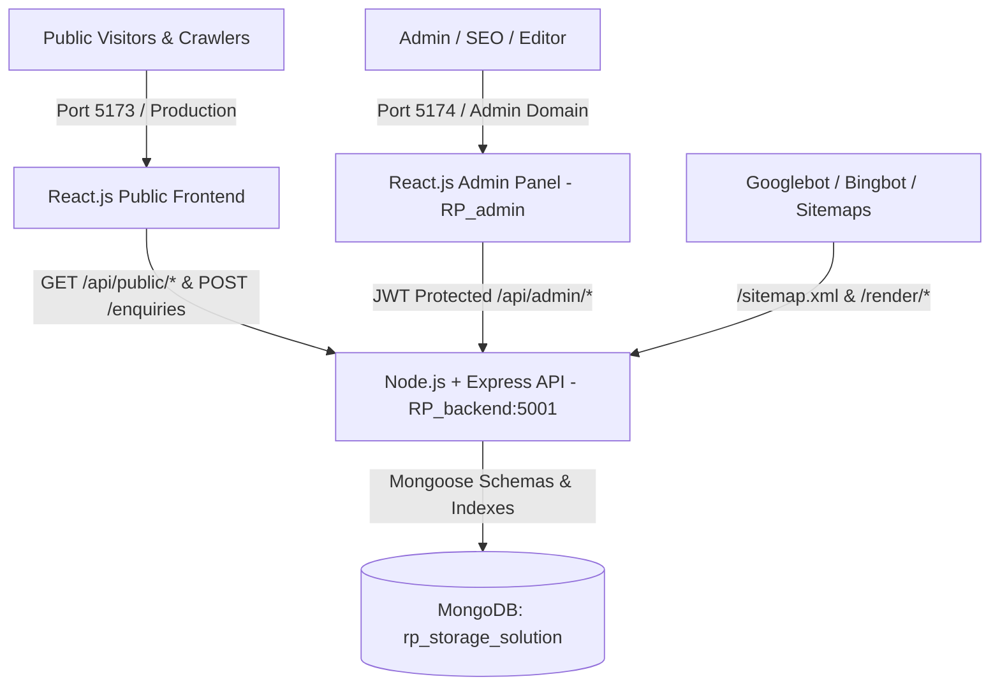

# RP Storage Solution — Full Stack Dynamic City SEO & Admin CMS System

Comprehensive documentation for the production-grade City-Based SEO Management System, Admin Panel (`RP_admin`), Node.js Backend (`RP_backend`), and React.js Public Website.

---

## 1. System Architecture Overview



---

## 2. Directory Layout

- **`/`**: Root Public Website (React.js + Vite + GSAP + Tailwind CSS + React Router DOM + Helmet)
  - `src/pages/Home.jsx`: 15 Homepage sections + dynamic "Areas We Serve" module.
  - `src/pages/Locations.jsx`: Verified distribution hub directory (`/locations`).
  - `src/pages/CityPage.jsx`: Dynamic City landing page (`/locations/:citySlug/`).
  - `src/pages/CityProductPage.jsx`: High-intent City + Product landing page (`/locations/:citySlug/:productSlug/`).
  - `src/pages/ProductPage.jsx`: Dynamic product specifications & detail page (`/products/:slug`).
  - `src/pages/NotFound.jsx`: 404 handler with delivery hub locator.
  - `src/components/seo/SEOHead.jsx`: JSON-LD Structured data, OpenGraph, Canonical tags.
  - `src/components/sections/AreasWeServe/`: Dynamic CMS section connected to live verified database.

- **`RP_admin/`**: Professional Enterprise SaaS Admin Panel (Port 5174)
  - `src/pages/Dashboard.jsx`: Real-time aggregated statistics from MongoDB.
  - `src/pages/Cities.jsx`: Full City CRUD, service verification guardrails, publishing workflow.
  - `src/pages/CityProducts.jsx`: Combinations manager, substantive content editor.
  - `src/pages/Products.jsx`: Catalog CRUD, specs, duplication, featured flags.
  - `src/pages/HomepageCMS.jsx`: Dynamic section toggle, custom headline & city selection.
  - `src/pages/Leads.jsx`: Leads pipeline, status updater, internal notes thread, CSV export.
  - `src/pages/SEOAudit.jsx`: Quality crawler detecting missing meta, thin content & canonical dupes.
  - `src/pages/SitemapInspector.jsx`: Live XML inspector, URL counter, cache purging.
  - `src/pages/MediaLibrary.jsx`: Multer image uploader, alt text tagger, URL clipboard.
  - `src/pages/Users.jsx`: Role-Based Access Control (RBAC) user manager.
  - `src/pages/Settings.jsx`: Global company details & immutable audit trail.

- **`RP_backend/`**: Node.js & Express REST Backend (Port 5001)
  - `src/models/`: MongoDB Schemas (`City`, `Product`, `CityProduct`, `HomepageContent`, `Enquiry`, `AdminUser`, `AuditLog`, `Redirect`, `SiteSettings`, `MediaAsset`).
  - `src/services/seoRenderer.js`: Prerendering & crawler middleware with HTML snapshot caching.
  - `src/controllers/`: Full CRUD, publishing lifecycle, audit logging, dynamic XML sitemaps.
  - `tests/system.test.js`: 12-test automated end-to-end integration test suite.

---

## 3. Seeded Accounts & Credentials

| Role | Email | Password | Access Scope |
| :--- | :--- | :--- | :--- |
| **Super Admin** | `admin@rpstorage.com` | `Admin@RP2026!` | Full access to users, settings, publishing, audit logs |
| **SEO Manager** | `seo@rpstorage.com` | `Seo@RP2026!` | City & Product SEO pages, review, approve, metadata |
| **Content Editor** | `editor@rpstorage.com` | `Editor@RP2026!` | Create & edit drafts, cannot publish without review |

---

## 4. Key Security & SEO Guardrails Implemented

1. **Service Coverage Guardrail**:
   - An unverified city cannot be published to live public routes or sitemaps.
   - Enforced in backend middleware (`cityController.js`) and UI form validation.
2. **Dynamic XML Sitemaps (`/sitemap.xml`)**:
   - Modular sitemaps for Products (`/sitemap-products.xml`), Locations (`/sitemap-locations.xml`), and City-Products (`/sitemap-city-products.xml`).
   - Automatically excludes drafts, unverified cities, and noindex items.
   - Instant cache invalidation whenever pages are published or unpublished.
3. **SEO Server Prerender & Real Status Codes**:
   - Bot detection intercepts search engines to serve pre-rendered HTML with full meta tags.
   - Nonexistent or unverified routes return a real HTTP 404 with `<meta name="robots" content="noindex, nofollow" />`.
   - Active redirects return real HTTP 301 responses.
4. **Zero AI Hallucinations**:
   - All addresses, contact numbers (`+91 99900 23436`), factory plant coordinates (Najafgarh, New Delhi), and steel specifications (IS 2062 / CRCA) reflect the authentic business facts of RP Storage Solution.

---

## 5. Development & Production Run Commands

### Running Locally

```bash
# Terminal 1: Backend Server (Port 5001)
cd RP_backend
npm install
node src/server.js

# Terminal 2: Admin Dashboard (Port 5174)
cd RP_admin
npm install
npm run dev -- --port 5174

# Terminal 3: Public Website (Port 5173)
cd /Users/rajjeet/Developer/RP
npm install
npm run dev -- --port 5173
```

### Running Test Suite

```bash
cd RP_backend
node tests/system.test.js
```
